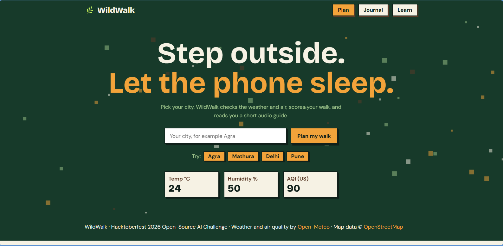
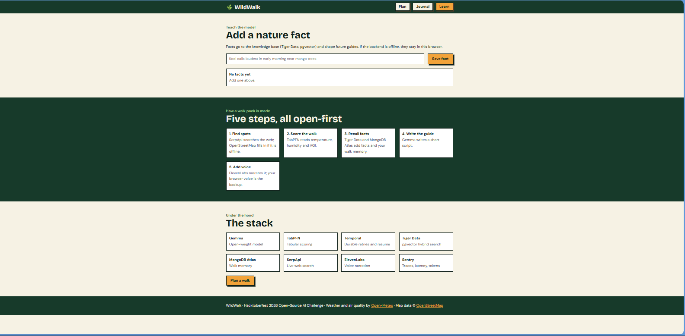
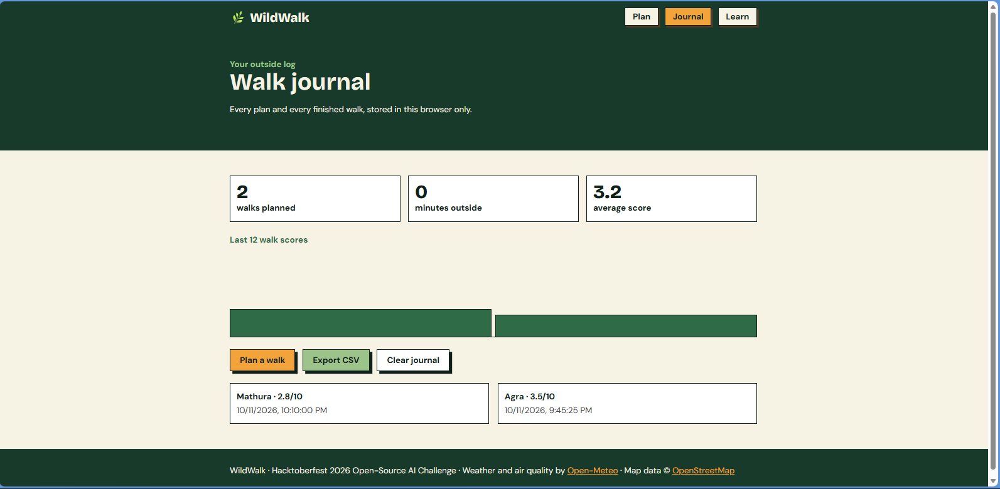

# 🌿 WildWalk

<p align="center">
  <video src="docs/demo.mp4" width="800" autoplay loop muted playsinline controls></video>
</p>

<p align="center">
  <b>Touch grass, not screens.</b><br>
</p>

WildWalk is a small, open-source tool that helps you decide whether to go outside today, and gives you a short audio guide for a screen-free walk. You enter your city. It checks the weather and air quality, gives the walk a score, suggests nearby places, and reads you a guide. Then you put your phone in your pocket and go.

Built for the **Hacktoberfest 2026 Open-Source AI Challenge** (Week 1: "Touch Grass").

---

## 📸 Screenshots

### Walk plan


### Learn


### Walk journal


---

## 🎯 The problem

Many people spend most of their day on screens and rarely go outside. Deciding whether a walk is worth it is often guesswork: is it too hot, is the air bad, where should I go? WildWalk gives one clear answer in one place, and helps you stay off your phone once you leave.

## 💡 Goal

Make going outside the easy choice:

- **Decide quickly:** a walk score from live weather and air quality.
- **Know where to go:** nearby parks and gardens from the web.
- **Leave the phone behind:** an audio guide and a pocket timer.
- **Stay consistent:** a walk journal and streaks.
- **Get better over time:** your ratings help the scoring model learn.

## ✨ Features

| Feature | What it does |
|---|---|
| **Walk plan** | Enter a city, get a score, verdict and a short guide |
| **Live weather** | Temperature, humidity and AQI from Open-Meteo (free, no key) |
| **Audio guide** | Guide is read aloud as an MP3 |
| **Nearby ideas** | Parks and walking spots from SerpApi |
| **Pocket mode** | Full-screen timer (10, 20 or 30 min) for a phone-free walk |
| **Walk journal** | History, stats, a chart and CSV export |
| **Learn** | Add nature facts that improve future guides |
| **Stack page** | Shows which tools are running |

## 🧠 How it works

```
Browser → FastAPI → Temporal workflow
                     ├─ SerpApi        → spots
                     ├─ TabPFN         → walk score
                     ├─ Tiger Data     → nature facts (pgvector search)
                     ├─ MongoDB Atlas  → your past walks (vector memory)
                     ├─ Gemma (Ollama) → writes the guide
                     └─ Edge TTS       → audio
```

If the backend is offline, the website falls back to a simple local score and guide, and tells you so.

## 🚀 Potential

- **Personal:** a daily "should I go out?" check that takes seconds.
- **Health:** a gentle nudge toward more outdoor time and fewer screen hours.
- **Air quality days:** clear advice on when and where to walk safely.
- **Community:** shared walk ratings could make recommendations better for each city.
- **Schools and offices:** short screen-break walks with a timer and simple challenges.
- **Open-source extension:** anyone can swap the model, add cities, or write new guide styles.

## ⚠️ Current status (honest)

- **Working now:** planning, scoring, guides, audio, pocket mode, journal, learn page.
- **Limits:** the TabPFN score is trained on synthetic seed data until real ratings come in. The local model is small, so guides are simple.
- **Not built yet:** cloud deployment (Render / DigitalOcean), fine-tuning (Tinker), model comparison (Backboard), hardware sensors (Arduino), and an agent (Mastra).

## ▶️ Quick start (Windows)

1. Clone or download this repo.
2. Double-click **`setup.bat`** (once). It installs everything and creates `.env`.
3. Add your keys to `.env`. See **[GUIDE.md](GUIDE.md)**.
4. Double-click **`start_all.bat`**. The site opens at `http://localhost:8000`.

## 🗂 Project structure

```
app/            backend: FastAPI, Temporal workflow, tool wrappers
static/         website: index, journal, learn pages, style.css, app.js
docs/           demo GIF and screenshots for this README
data/           walk data (CSV) used by TabPFN
audio/          generated MP3 guides (not committed)
setup.bat       one-time setup
start_all.bat   start everything
GUIDE.md        step-by-step setup and keys
```

## 🛠 Tools used

| Tool | Role |
|---|---|
| Gemma (Ollama) | Open-weight model that writes the guide |
| TabPFN | Predicts walk enjoyment from tabular data |
| Temporal | Durable workflow with retries and resume |
| Tiger Data | Postgres with pgvector for fact search |
| MongoDB Atlas | Vector memory of past walks |
| SerpApi | Live web search for nearby spots |
| Edge TTS | Free natural voice for the guide |
| Sentry | Traces, errors and LLM latency (optional) |

## 📜 License and notices

- Code: MIT (add a `LICENSE` file).
- TabPFN model weights are for **non-commercial use** under the Prior Labs license. Accept the license at ux.priorlabs.ai before first run.